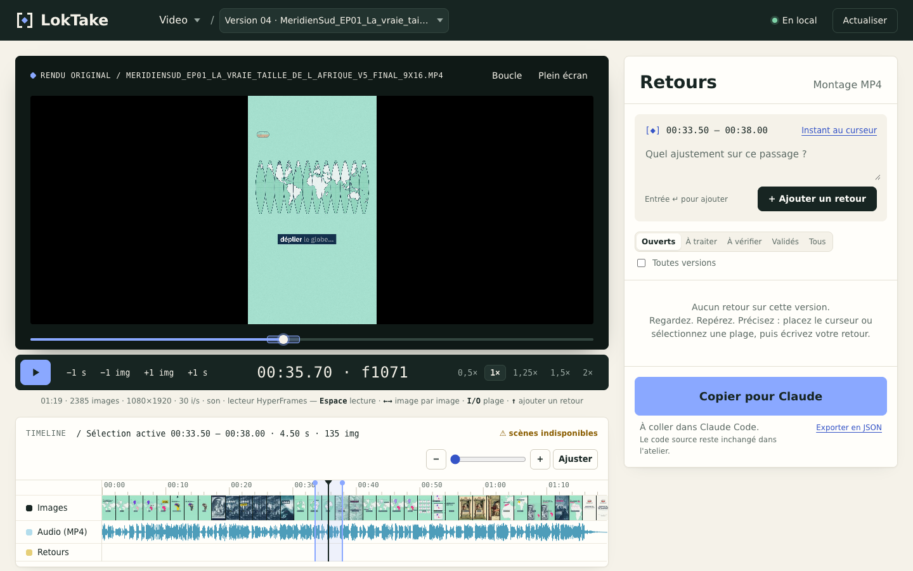

# LokTake

Application locale pour **visionner, annoter et corriger** les vidéos de motion design créées avec
[HyperFrames](https://hyperframes.heygen.com), puis transmettre les demandes à Claude Code.



```
Claude code la vidéo (HyperFrames) → npx hyperframes render → LokTake : je regarde,
je marque des instants et des plages, j'écris mes retours → « Copier pour Claude » →
je colle dans Claude Code → Claude modifie le code source et produit un nouveau rendu → …
```

## Démarrage

Prérequis : **Node.js ≥ 22**, **ffmpeg** et **ffprobe** dans le `PATH` (déjà requis par HyperFrames).

```bash
git clone https://github.com/Lokman212/loktake.git
cd loktake
npm install
```

```bash
npm start -- ~/chemin/vers/mes-projets-hyperframes
```

Le navigateur s'ouvre sur `http://127.0.0.1:8093/`. Le dossier donné peut être **un projet**
HyperFrames ou un dossier qui **contient** des projets (recherche sur 2 niveaux). Un projet est
reconnu par son `hyperframes.json` (ou un `index.html` contenant `data-composition-id`).

Options : `--port 8093`, `--host 127.0.0.1`, `--no-open`. Plusieurs dossiers sont possibles.
Variable d'environnement équivalente : `LOKTAKE_ROOTS=~/videos:~/clients`.

Les versions sont les MP4 de `renders/` (y compris sous-dossiers) et ceux posés à la racine du
projet. Un nouveau rendu est détecté automatiquement (vérification toutes les 5 s) ; s'il est apparu
depuis la dernière session, il est ouvert en priorité.

## Ouverture automatique dans l'app Claude après chaque rendu

`--background` démarre le serveur s'il ne tourne pas déjà (ou lui ajoute le projet), affiche
l'adresse du projet et rend la main :

```bash
node ~/Projets/loktake/bin/loktake.js ~/HyperFrames/mon-projet --background --no-open
```

Pour que Claude Code le fasse tout seul après chaque rendu et ouvre la vidéo dans le navigateur
intégré, colle le contenu de [`docs/CLAUDE-snippet.md`](docs/CLAUDE-snippet.md) dans
`~/.claude/CLAUDE.md` (valable pour tous tes projets), en adaptant le chemin du dossier du projet.
C'est une consigne donnée à Claude, pas un automatisme garanti : s'il l'oublie, demande-lui
« ouvre LokTake ». Elle ne fonctionne que dans une session locale de l'app de bureau :
une session cloud n'a pas accès au `localhost` de ton ordinateur.

## Architecture (choisie après inspection d'HyperFrames 0.8.229)

| Besoin | Solution retenue | Pourquoi |
|---|---|---|
| Lecture | composant officiel **`<hyperframes-player>`** en mode vidéo (`type="video/mp4"`), repli automatique sur `<video>` | même API play/pause/seek/vitesse que le reste de l'écosystème HyperFrames, sans réimplémenter de lecteur |
| Scènes / éléments | **`hyperframes timeline --json`** (analyse statique, sans navigateur) | donne l'`id`, la piste, le fichier source (`compositions/…`) et les instants de chaque clip : c'est ce qu'il faut pour dire à Claude *où* intervenir |
| Coupes | **ffmpeg** (trim à l'image + concat), dans un **nouveau fichier** | HyperFrames n'a pas de coupe de MP4 ; et ses commandes `timeline split/delete` modifient le *code*, ce que LokTake ne fait jamais |
| Serveur | Node.js sans framework (`node:http`), streaming HTTP Range | aucune dépendance en plus d'HyperFrames ; le déplacement dans la vidéo exige le Range |
| Interface | HTML/CSS/JS modules, sans étape de build | se lance avec `npm start`, rien à compiler |

Le **studio HyperFrames** (`hyperframes preview`) n'est pas réutilisé comme base : il prévisualise et
modifie la composition HTML, alors que la revue porte ici sur le MP4 rendu, c'est-à-dire ce qui est livré.

```
bin/loktake.js          lancement (CLI)
server/                 index (routes), projects (projets + versions), annotations, cuts (coupes +
                        vérification), media (ffprobe/ffmpeg/Range), hf (CLI HyperFrames), store (JSON atomique)
shared/                 logique pure partagée navigateur/serveur : temps, correspondance des coupes, export Claude
web/                    interface (index.html, styles.css, js/…) ; web/assets/ = logo, favicon
test/                   tests unitaires + d'intégration (npm test) et parcours complet Playwright (npm run e2e)
```

## Identité visuelle


**LokTake** — *Lok* : la signature de Lokman ; *Take* : la prise, la version vidéo ; le signe :
deux crochets encadrent une plage, le losange marque l'instant. « Le bon retour. À la bonne image. »

| Rôle | Couleur |
|---|---|
| Encre — texte et lecteur | `#172522` |
| Ivoire — fond de travail | `#F5F2E9` |
| Pervenche — action et sélection | `#8AA8FF` |
| Craie — panneaux | `#FFFEFA` |
| Sauge — texte secondaire | `#5E6C66` |

Typographies : **DejaVu Sans** (interface) et **DejaVu Sans Mono** (temps, versions, images),
servies localement depuis le paquet `dejavu-fonts-ttf`. Grille de 8 px, rayons de 8 px ; les
statuts ont toujours un mot et une icône (◆ À traiter, ! À vérifier, ✓ Validé).
Fichiers du logo dans `web/assets/` : signe et logotype en versions claire, sombre et monochrome,
favicon simplifié 16 px.

## Données sur disque (dans chaque projet)

```
mon-projet/
  .loktake/
    annotations.json     toutes les annotations, toutes versions (à versionner avec git si tu veux)
    versions.json        registre des versions : fichier, empreinte, durée, i/s, scènes capturées
    edits/<version>.json brouillons de coupe avec historique annuler/rétablir
    settings.json        dernière version / position (reprise de session)
    cache/               forme d'onde, vignettes, timeline (ignoré par .loktake/.gitignore)
  renders/
    loktake-montages/    MP4 montés + fiche <fichier>.loktake.json + images de raccords
```

Exemple d'annotation :

```json
{
  "id": "LT-003",
  "projectId": "26-10-06-pere-noel-et-cie-iso",
  "versionId": "pere-noel-cie-v03-1a2b3c",
  "versionFile": "renders/pere-noel-cie-v03.mp4",
  "fps": 30,
  "kind": "range",
  "start": 12.4,
  "end": 14.0,
  "comment": "Le traîneau traverse trop vite, ralentir l'easing.",
  "status": "a_traiter",
  "targets": [{ "id": "sleigh-layer", "sourceFile": "compositions/sleigh.html", "trackKind": "graphics", "auto": true }],
  "needsReposition": false,
  "createdAt": "2026-11-02T00:01:00.000Z",
  "updatedAt": "2026-11-02T00:01:00.000Z"
}
```

Une annotation reportée porte en plus `origin` (annotation et version d'origine) et
`mapping` (`exacte` / `probable` / `incertaine` + raison). Les écritures sont atomiques
(fichier temporaire + renommage) ; un fichier illisible est mis de côté, jamais écrasé.

## Fonctions opérationnelles

Toutes vérifiées par `npm run e2e` dans un vrai Chromium, sur un projet HyperFrames réel rendu
avec la CLI 0.8.229 (et sur un projet témoin généré).

**Lecteur**
- Sélecteur de projet et de version (rendus HyperFrames et MP4 montés séparés).
- Grande prévisualisation sur fond noir, **plein écran** (bouton ou `F`).
- Lecture/pause, ±1 image, ±1 s, vitesses 0,5× à 2×, temps `mm:ss.cc · f###`.
- Boucle sur la sélection (`L`).

**Timeline**
- Règle temporelle (graduations jusqu'à l'image), tête de lecture synchronisée, zoom
  (curseur, boutons, Ctrl/⌘ + molette, « Ajuster »), défilement qui suit la lecture.
- Vignettes du film, **scènes HyperFrames** par piste (double-clic = sélectionner la scène),
  forme d'onde de l'audio du MP4, marqueurs d'annotations colorés par statut, ligne des coupes.
- Avertissement si la correspondance scènes ↔ rendu est incertaine (code modifié après le rendu).

**Annotations**
- Instant (curseur) ou plage (glisser sur la timeline, ou `I` / `O`).
- Scènes/éléments concernés détectés automatiquement, activables/désactivables (les pistes audio sont
  désactivées par défaut).
- Statuts : à traiter, à vérifier, validé. Filtres par statut, « toutes versions ».
- Clic sur une annotation (liste ou marqueur) = retour au passage, plage resélectionnée ;
  une annotation d'une autre version ouvre cette version.
- Modifier le texte, replacer au curseur, supprimer (avec « Annuler »).
- Sauvegarde immédiate sur disque, rechargement au redémarrage, reprise à la dernière position.

**Export**
- **Copier pour Claude** : texte Markdown avec chemin du projet, version, demandes *à traiter*
  (temps, images, scènes et fichiers sources), retours *à vérifier* et *validés* marqués « ne pas
  modifier », et coupes MP4 explicitement séparées du code.
- **Exporter les annotations en JSON** : toutes versions, avec métadonnées des versions.

**Coupes (onglet « Montage MP4 »)**
- **Scinder au curseur** (`S`) : pose une frontière, ne supprime rien.
- **Supprimer la sélection et raccorder** (`Suppr`) : supprime la plage sélectionnée, ou le segment
  entre deux scissions sous le curseur.
- Réversible : annuler/rétablir (`Ctrl+Z` / `Ctrl+Maj+Z`), « Restaurer » une plage, « Retirer » une
  scission, « Tout rétablir ». Brouillon conservé sur disque.
- Aperçu immédiat : la lecture saute les passages supprimés (le fichier n'est pas modifié).
- Effets prévus avant rendu, d'après la timeline : scène amputée en entrée/sortie, coupe au milieu
  d'une animation GSAP, transition entre scènes touchée, raccord proche d'une frontière, musique ou
  voix coupée en plein milieu.
- **Générer le MP4 monté** : nouveau fichier dans `renders/loktake-montages/`, le rendu d'origine est
  intact (vérifié par empreinte dans les tests). Rapport de vérification :
  nombre d'images et durée attendus, synchronisation audio/vidéo, **images de part et d'autre de chaque
  raccord comparées à la source** (aucune image perdue ni dupliquée), saut de niveau sonore au
  raccord comparé aux variations naturelles du son d'origine, planche d'images du raccord.
- « Reprendre ce montage » recharge sa liste de coupes dans le brouillon ; « Supprimer ce MP4 monté »
  n'efface que le fichier dérivé.

**MP4 ≠ code source** : un montage est étiqueté « MP4 monté » partout (badge, liste des versions,
bandeau, onglet, fiche `.loktake.json`, texte pour Claude). Le texte pour Claude précise qu'il n'a
**pas** modifié le code, et donne pour chaque retour l'instant équivalent dans le rendu d'origine.

**Versions et report des annotations**
- Les annotations restent attachées à leur version ; rien n'est déplacé ni effacé.
- Après une coupe, elles sont **copiées** sur le montage : position **exacte** si le passage est
  intact ; **à repositionner** si tout ou partie du passage a été supprimé.
- Après un nouveau rendu HyperFrames, un bandeau propose « Reporter ici » : la copie suit la scène
  ciblée si elle existe encore (décalage pris en compte). La correspondance n'est jamais certaine
  (le code a changé) : chaque copie est marquée **à repositionner** jusqu'à « Position OK » ou
  « Placer au curseur ». Les retours « à traiter » passent « à vérifier ».
- Un rendu réécrit sous le même nom devient une nouvelle version ; l'ancienne est marquée
  « fichier remplacé » et ses annotations restent lisibles.

## Raccourcis

| Touche | Action |
|---|---|
| Espace / K | lecture / pause |
| ← / → | image précédente / suivante |
| Maj + ← / → | −1 s / +1 s |
| Début / Fin | début / dernière image |
| I / O | début / fin de plage au curseur |
| Échap | effacer la sélection |
| ↑, Entrée ou M | écrire un retour (met en pause) |
| Entrée (dans le champ) | ajouter le retour (Maj+Entrée : retour à la ligne) |
| F | plein écran |
| L | boucle sur la sélection |
| S *(onglet Montage)* | scinder au curseur |
| Suppr *(onglet Montage)* | supprimer la sélection et raccorder |
| Ctrl/⌘ + Z, Ctrl/⌘ + Maj + Z *(onglet Montage)* | annuler / rétablir une coupe |

## Tests

```bash
npm test
```

```bash
npm run e2e -- /chemin/vers/un-projet-hyperframes
```

`npm test` : logique des temps et des coupes, export pour Claude, et deux coupes réelles ffmpeg
(exactitude à l'image, source intacte, détection d'un vrai saut audio, pas de fausse alerte).
`npm run e2e` : parcours complet dans Chromium (Playwright) — ouvrir, lire, annoter, fermer,
redémarrer le serveur, rouvrir, cliquer pour revenir au passage, copier pour Claude, exporter,
scinder, supprimer, annuler, rétablir, générer et vérifier le montage, report des annotations.
Le projet est **copié** dans un dossier temporaire : l'original n'est pas touché. Sans argument, un
projet témoin est généré. `--shots DOSSIER` enregistre des captures.

## Limites restantes

- **Pas encore essayé sur ton projet réel** : il n'était pas accessible depuis la session cloud.
  Tout a été vérifié sur un vrai projet HyperFrames 0.8.229 (exemple « warm-grain » + piste audio,
  rendus v01/v02 avec la CLI) et sur un projet témoin.
- **Scènes** : ce sont les clips que `hyperframes timeline --json` expose (premier niveau, et les
  enfants s'il y en a). Les éléments internes d'une sous-composition ne sont pas détaillés si la CLI
  ne les liste pas. Pour un rendu antérieur à la dernière modification du code, la correspondance est
  marquée **incertaine** : LokTake ne conserve pas l'état du code au moment du rendu.
- **Report vers un nouveau rendu** : heuristique (même scène ciblée, ou même structure). Elle n'est
  jamais présentée comme certaine ; une confirmation manuelle reste nécessaire.
- **Coupes** : ré-encodage H.264 (CRF 16, `preset medium`) et AAC 192 kb/s, donc pas sans perte ;
  micro-fondu audio de 6 ms à chaque raccord. Pas de fondu enchaîné ni de transition ajoutée. Coupes
  préparées uniquement sur un rendu d'origine (un montage se modifie via « Reprendre ce montage »).
  Vidéos à cadence constante supposées ; HDR non géré.
- **Analyse des effets** : déduite des instants de la timeline, pas de l'analyse des images ;
  elle signale les risques (animation en cours, transition, musique) sans les mesurer visuellement.
  Les images de raccord sont là pour juger à l'œil.
- **Transmission** : par copier-coller uniquement (pas d'intégration directe à Claude Code). Le
  bouton « Envoyer au monteur » de la capture de référence n'a pas été repris.
- **Formats** : ceux que le navigateur lit (MP4 H.264, WebM ; un `.mov` ProRes ne se lira pas).
- Forme d'onde et vignettes sont calculées à la première ouverture d'une version (quelques secondes
  pour un long film), puis mises en cache.
- Les cibles (scènes) d'une annotation existante ne se modifient qu'en la replaçant au curseur.
- Application mono-utilisateur, sans authentification, écoute sur `127.0.0.1` uniquement.
